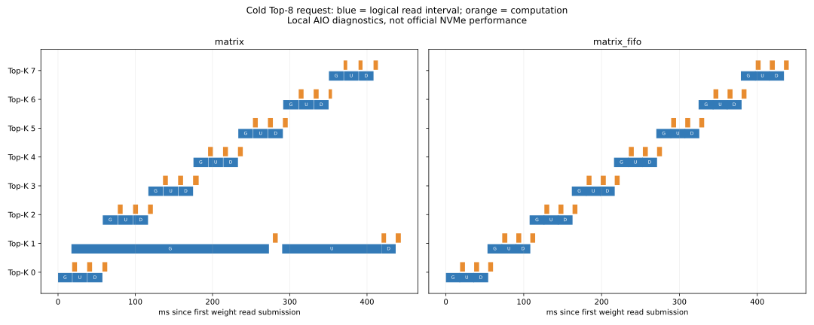

# Matrix FIFO validation, 2026-10-13

## Outcome

The optional FIFO implementation works and removes completion dependencies between
matrix read submissions. It did **not** demonstrate a stable local P99 improvement.
The existing `matrix` mode remains the default. No compressed inference backend is
enabled: the tested compression prototypes did not pass the throughput screen.

These results use a Xeon Gold 6248 host and a Samsung MZQLB7T6HALA NVMe through Linux
AIO, not the official Xeon Silver 4214 and SPDK native-NVMe environment. They must
not be presented as official scores or parameters optimized for that hardware.

## Accuracy and failures

- Three independently generated small weight sets, seeds 42/43/44, each passed 50
  distinct inputs against the separately linked reference: maximum absolute error 0.
- Official dimensions (2048/7168, 256 experts, Top-8), existing supplied weight set:
  50 inputs from seed 4242 passed the independent TCP vendor-command plus READ
  initiator, every request with maximum absolute error 0, strictly below `1e-5f`.
- The full-size check used one available weight set. Three independent full-size
  weight sets, hidden official validation and the official cgroup remain external
  acceptance gates; small weight seeds do not substitute for those tests.
- FIFO integration cases passed for 1/2/4 compute threads, hit/miss/eviction,
  truncation, removal, slow I/O, shutdown, and invalid Gate/Up/Down followed by
  recovery. Insufficient cache slots are rejected.
- The store test passed reverse completions, FIFO address order, cross-matrix
  submission before completion, batch cancellation, ENOMEM retry and cancellation
  while a wait callback still owned its buffer.
- Incremental builds, Python syntax checks and `git diff --check` passed. Repository
  `check_format.sh` is not a passing gate: it reports pre-existing issues and missing
  astyle/markdownlint/pycodestyle/shellcheck. Its newly introduced `atoi` finding was
  fixed with checked `strtol` parsing.

## P99 comparison

Each run used 16 warmup requests (seed 777), then exactly 50 measured requests (seed
42). Input digests matched. AVX2, one compute worker on CPU 1, reactor CPU 10,
initiator CPU 0, 1 MiB chunks, depth 4. Diagnostics were disabled. Nearest-rank P99
is the maximum of 50 samples; these runs cannot estimate official P99.99.

| Mode | First P99, ms | Repeat 1 | Repeat 2 |
|---|---:|---:|---:|
| Existing matrix, 7 slots | 445.437 | — | — |
| Existing matrix, 8 slots | 445.145 | 445.480 | 445.235 |
| Matrix FIFO, 8 slots | 805.971 | 444.300 | 446.958 |

FIFO's first run contained request latencies of 805.971, 758.638 and 500.903 ms.
Their cause was not established. All seven runs recorded zero cgroup CPU throttling
increments. Do not discard these tails or claim a win from the fastest repetition.
The median of the three per-run P99 values was 445.235 ms for the old eight-slot
mode and 446.958 ms for FIFO; this aggregation is descriptive, not an official P99.

Eight-slot target process HWM was at most 1,493,300 KiB, with no hugepages. The SPDK
reservation was 1664 MiB. These are local process measurements, not certification
of all memory charged by the official cgroup/hugepage configuration.

## Submission trace

Separate short diagnostic runs show the first cold request in each mode:

| Measurement | Existing 8-slot matrix | FIFO |
|---|---:|---:|
| Weight bytes read | 1,409,286,144 | 1,409,286,144 |
| Next matrix submitted before previous completion | 0/16 | 16/16 |
| First expert computation begins, ms from request start | 19.881 | 19.832 |
| Time with logical I/O outstanding, ms | 437.067 | 434.302 |
| Mean logical depth while I/O outstanding | 3.846 | 3.844 |

The baseline diagnostic run recorded two CPU throttle increments over its whole
startup/test interval; these traces demonstrate ordering, not a reliable speedup.
Both modes already maintain almost four logical reads in flight. The matrix-level
read intervals include software queueing and do not measure physical PCIe traffic.



## Lossless compression

Twenty-six candidates were checked on held-out experts 0/128/255, all three
matrices. They cover LZ4/Zstd level 1, raw/byte/bit transforms, 1/4/8/56 MiB units,
and global/stage dictionaries for the fastest estimated Zstd candidate. Dictionary
training used other experts from the actual image. Byte-for-byte restoration
passed for every tested block; tests also cover signed zero, infinities, NaN bit
patterns, corruption, wrong dictionaries and length mismatches.

| Candidate | Stored/original, including alignment/index | Prototype restore GB/s |
|---|---:|---:|
| Zstd, raw bytes, whole matrix | 91.27% | 0.725 |
| Zstd, byte shuffle, 1 MiB | 81.67% | 0.438 |
| Zstd, bit shuffle, whole matrix | 80.96% | 0.044 |
| Zstd, raw bytes, 4 MiB | 91.31% | 1.082 |

Global and stage dictionaries did not improve the raw-byte 4 MiB candidate's
storage ratio after their own storage cost was included.

The fastest estimated genuinely compressing non-dictionary candidate (Zstd/raw
bytes/4 MiB) was then verified on **all 256 experts**: 45,097,156,608 original bytes,
41,178,271,744 accounted stored bytes, ratio 91.3101%, exact restoration. Its full
verification prototype restored about 1.009 GB/s. Source weight SHA-256:

```text
e7cad018b70e48c959d962d1f82a64a3bd98a747968317afeb95e03c096c17ba
```

These timings include Python allocation, copies and NumPy inverse transformations;
they are **not** native decoder limits. Native SIMD filters remain unmeasured. Even
ideal I/O/decode overlap requires recovery throughput close to the uncompressed
SSD throughput to avoid becoming the bottleneck. No compressed-path P99 or compressed
TCP inference accuracy result is claimed. A future native decoder must pass both
the exact-weight and official-output checks before becoming a performance candidate.

Detailed local artifacts are under `/root/moe-run-logs/matrix_fifo_20261013/`:
`p99/results.json`, individual latency JSONL files, `compression.json`, independent
accuracy logs, `diagnostics_summary.json`, and the timeline SVG. Reproduction commands
and interfaces are documented in [matrix_fifo.md](matrix_fifo.md).
